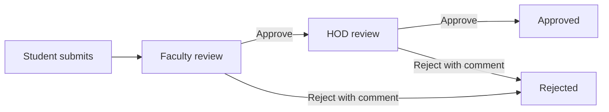
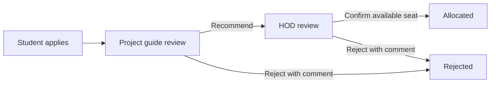
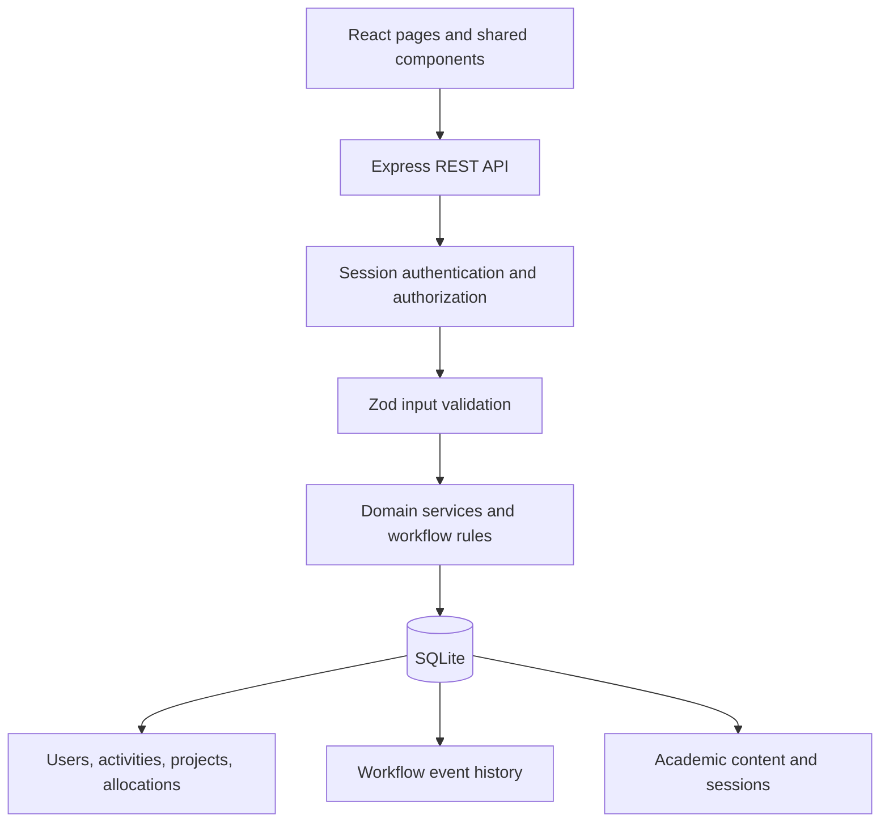

# DeptFlow

### Department Activity & Project Management

A full-stack departmental workspace for managing undergraduate (UG) and postgraduate (PG) activities, faculty reviews, HOD approvals, student supervision, and project allocation.

DeptFlow is an academic lab project demonstrating **workflow-based architecture** and **software interface design**. It combines a responsive React interface with an Express API and a persistent SQLite database.

## Contents

- [Overview](#overview)
- [Features](#features)
- [Roles and permissions](#roles-and-permissions)
- [Tech stack](#tech-stack)
- [Getting started](#getting-started)
- [Environment configuration](#environment-configuration)
- [Demo accounts](#demo-accounts)
- [How the workflows work](#how-the-workflows-work)
- [Architecture](#architecture)
- [Project structure](#project-structure)
- [Database](#database)
- [API overview](#api-overview)
- [Available commands](#available-commands)
- [Testing and verification](#testing-and-verification)
- [Lab demonstration](#lab-demonstration)
- [Troubleshooting](#troubleshooting)
- [Scope and acknowledgements](#scope-and-acknowledgements)

## Overview

Department activities often involve several people: a student initiates a request, a faculty member reviews it, and the HOD makes the final decision. Project allocation adds eligibility, guide assignment, and seat-capacity constraints.

DeptFlow brings these processes into one workspace. Each user sees the records and actions relevant to their role, and every submission and decision is recorded in a visible timeline.

The application supports one department, two programme levels, and three roles: **Student**, **Faculty**, and **HOD**.

## Features

### Authentication and dashboards

- Email/password login with role-based access and SQLite-backed sessions.
- Session restoration on refresh, logout, and automatic return to sign-in when a session expires.
- Personalized dashboards with live request counts, recent activity, project status, relevant notices, and upcoming dates.
- Server-side authorization for records and actions, in addition to protected frontend routes.

### UG/PG activity management

- Student requests for seminars/workshops, industrial visits, academic events, and leave/permission.
- Activity title, category, date range, description, and purpose.
- Assigned faculty review followed by HOD approval.
- Approval or rejection with required reviewer comments.
- Status tracking and chronological history with reviewer identities and timestamps.
- Search and filters by category, status, and programme.

### Projects and allocations

- Project catalogue with description, faculty guide, UG/PG eligibility, capacity, and remaining seats.
- Faculty/HOD creation and editing of project offerings.
- Student applications with a statement of interest.
- Guide recommendation followed by HOD confirmation.
- Application history and confirmed student–project–guide allocation records.
- One active project application or allocation per student.
- Transactional capacity checks that prevent over-allocation.
- Validation of offering changes against existing allocations and pending applications.

### Student supervision and faculty oversight

- Faculty **My Students** views for assigned advisees and project applicants/students.
- Student profiles with roll number, email, programme, admission batch, semester, advisor, activity history, and project status.
- Separate academic-advisor and project-guide relationships.
- Restricted project-only profiles for guides who are not a student's advisor.
- HOD student directory with programme, semester, batch, advisor, and project-status filters.
- HOD faculty overview with supervision counts, offerings, pending reviews, and drill-down links.
- Unified review queue for actionable activity and project requests.

### Academic Hub

- **Noticeboard:** academic announcements, event information, and registration/project reminders.
- **Dates & Schedules:** academic milestones, deadlines, presentation dates, and schedule references.
- **Resources:** curriculum, syllabus, regulations, timetables, examination schedules, and registration reference links.
- HOD draft, publish, edit, and archive controls.
- Student audience targeting by UG/PG, semester, and admission batch.
- Search and filters by content type, programme, semester, academic year, and publishing state where permitted.

### Interface and usability

- Responsive desktop, tablet, and phone layouts.
- Mobile navigation drawer, keyboard focus management, Escape-to-close, and a skip-to-content link.
- Consistent forms, status badges, cards, timelines, and searchable lists.
- Loading, empty, error, retry, success, and validation states.
- Accessible control labels and error descriptions.
- External resources clearly identified and opened in a separate tab.

## Roles and permissions

| Area | Student | Faculty | HOD |
| --- | --- | --- | --- |
| Dashboard | Own activities and project journey | Assigned reviews and supervision | Department overview |
| Activity requests | Submit and track own requests | Review assigned advisor requests | Final decision after faculty approval |
| Projects | Browse eligible projects and apply | Manage own offerings and review applications | Manage all offerings and confirm allocations |
| Students | Own profile | Advisees and scoped project students | All department students |
| Faculty overview | — | Own counts on dashboard | Department-wide oversight |
| Academic Hub | Relevant published content | Published content | Create, edit, publish, and archive |
| Workflow history | Own records | Authorized records | Department-wide records |

A faculty member cannot review another advisor's activity requests or another guide's project applications. HOD approval cannot bypass the faculty/guide stage.

## Tech stack

| Layer | Technology | Purpose |
| --- | --- | --- |
| Frontend | React | Component-based user interface |
| Routing | React Router | Navigation and protected role-based screens |
| Frontend tooling | Vite | Development server, API proxy, and production build |
| Styling | CSS | Shared design tokens and responsive layouts |
| Icons | Lucide React | Consistent interface icons |
| Backend | Node.js 24+ and Express | REST API and serving the built frontend |
| Database | SQLite through Node's built-in `node:sqlite` | Local persistence, queries, constraints, and transactions |
| Authentication | express-session and a custom SQLite session store | Server-managed login sessions |
| Passwords | bcryptjs | Password hashing and verification |
| Validation | Zod | Request validation |
| Configuration | dotenv | Root-level environment configuration |
| Backend tests | Node test runner and Supertest | API, workflow, and persistence verification |
| Browser tests | Playwright with Microsoft Edge | End-to-end journeys and responsive/keyboard checks |
| Accessibility checks | axe-core | Automated checks on representative screen states |
| Development scripts | npm workspaces and concurrently | Manage client and server from the project root |

No separate database server, SQLite installation, or C++ compiler is required.

## Getting started

### Prerequisites

- **Node.js 24 or newer**.
- npm, included with Node.js.
- Microsoft Edge if you want to run the browser test suite.

Check your installation:

```sh
node --version
npm --version
```

### 1. Install dependencies

Clone or download the repository, open a terminal in its root directory, and run:

```sh
npm ci
```

Run commands from the folder containing `package.json`, `client/`, and `server/`. For a checkout named **DeptFlow**, open your terminal inside that folder.

### 2. Configure the environment

Copy `.env.example` to `.env`.

PowerShell:

```powershell
Copy-Item .env.example .env
```

macOS/Linux:

```sh
cp .env.example .env
```

Replace the example `SESSION_SECRET` with your own random value. You can generate one with:

```sh
node -e "console.log(require('node:crypto').randomBytes(32).toString('hex'))"
```

The application can run without a `.env` file. In that case, it generates a random session secret at startup, so existing login sessions become invalid after a server restart. Academic records remain saved.

### 3. Start development mode

```sh
npm run dev
```

Open **http://127.0.0.1:5173**.

- React/Vite runs on port **5173**.
- Express runs on port **3001**.
- Vite proxies `/api` requests to Express.
- The SQLite schema and demo data are initialized automatically on the first backend startup.
- Keep the terminal open; press **Ctrl+C** to stop the application.

### Run the built application on one port

```sh
npm run build
npm start
```

Open **http://127.0.0.1:3001**. Express serves both the API and the built React application.

Build before starting, and restart Express after a new build. Both run modes bind to the local machine.

## Environment configuration

Configuration is read from the root `.env` file.

| Variable | Default | Description |
| --- | --- | --- |
| `PORT` | `3001` | Express listening port |
| `SESSION_SECRET` | Random value at startup | Session-signing secret; keep it stable to retain sessions across restarts |
| `DATABASE_PATH` | `server/data/deptflow.sqlite` | Optional custom database path; an absolute path is recommended |
| `COOKIE_SECURE` | `false` | Set to `true` only when serving through HTTPS |

For development, keep `PORT=3001` unless you also update the API proxy in `client/vite.config.js`. Leave `COOKIE_SECURE` unset or false for local HTTP.

Real environment files are ignored by Git. **Commit `.env.example`**, which contains placeholders and documents the required settings.

## Demo accounts

Use the email address as the username. All seeded accounts use **`Demo@123`**.

| Role | Name | Email | Programme / responsibility |
| --- | --- | --- | --- |
| HOD | Dr. Mira Sen | `hod@deptflow.edu` | Department oversight |
| Faculty | Dr. Aarav Mehta | `aarav@deptflow.edu` | Advisor to Ananya and Ishaan |
| Faculty | Dr. Kavya Rao | `kavya@deptflow.edu` | Advisor to Diya and Arjun |
| Faculty | Dr. Rohan Das | `rohan@deptflow.edu` | Advisor to Sana and Neel |
| Student | Ananya Sharma | `ananya@deptflow.edu` | UG, semester 7 |
| Student | Ishaan Patel | `ishaan@deptflow.edu` | UG, semester 7 |
| Student | Diya Mukherjee | `diya@deptflow.edu` | UG, semester 5 |
| Student | Arjun Roy | `arjun@deptflow.edu` | PG, semester 3 |
| Student | Sana Khan | `sana@deptflow.edu` | PG, semester 3 |
| Student | Neel Banerjee | `neel@deptflow.edu` | PG, semester 1 |

The login page offers quick-fill buttons for UG Student, PG Student, Faculty, and HOD. These fill credentials; sign-in still verifies them.

A fresh seed includes pending, approved, rejected, and allocated records. Ananya and Neel begin without requests for live demonstrations. Diya's advisor and project guide differ to demonstrate scoped supervision. All people and sample announcements are fictional.

## How the workflows work

### Activity approval



1. The student's programme and assigned advisor come from their authenticated profile.
2. The advisor reviews the request and records a comment.
3. Approved requests move to the HOD for a final decision.
4. Every submission and decision appears in the timeline.

### Project allocation



The server checks programme eligibility, project availability, existing applications, and seat capacity. Pending applications **do not reserve seats**. Final allocation checks and saves the seat in a database transaction.

### Workflow rules

- Review comments are required for approval and rejection.
- One student can have at most one active project application or allocation.
- Rejected requests are terminal; the student can submit a new request.
- Repeated or stale decisions return a conflict without creating duplicate history.
- Capacity cannot be reduced below confirmed occupancy.
- Projects with pending applications cannot be deactivated.
- Project eligibility cannot change while active applications or allocations exist.
- Draft and archived Academic Hub content is visible only to the HOD.
- A student cannot bypass academic audience restrictions with filters or a direct URL.

## Architecture



- **Interface layer:** React pages share navigation, forms, badges, cards, and timelines. Context manages authenticated-user state and refreshes.
- **API layer:** Express routes authenticate requests, enforce record access, and validate payloads.
- **Domain layer:** Services define the allowed workflow transitions and project-allocation rules.
- **Persistence layer:** SQLite stores records, sessions, and history. Foreign keys, unique indexes, and transactions protect consistency.

A workflow transition runs inside `BEGIN IMMEDIATE`: check the current state, authorize the reviewer, validate business rules, update status, write the event, and create the allocation when applicable. The transaction commits together or rolls back together.

Passwords are hashed. Sessions use HttpOnly, SameSite cookies. SQL queries are parameterized, and password hashes are omitted from API responses.

## Project structure

```text
.
├── client/
│   ├── public/                 # Static assets
│   ├── src/
│   │   ├── components/         # Shared UI and application shell
│   │   ├── context/            # Session state and data hooks
│   │   ├── lib/                # API client and formatting helpers
│   │   ├── pages/              # Role-aware application screens
│   │   ├── main.jsx            # Routes and React entry point
│   │   └── styles.css          # Design system and responsive styles
│   └── vite.config.js
├── server/
│   ├── data/                   # Ignored runtime database files
│   ├── src/
│   │   ├── db/                 # Schema, connection, seed, and CLI
│   │   ├── middleware/         # SQLite session store
│   │   ├── services/           # Domain rules and input validation
│   │   ├── app.js              # Express application and API routes
│   │   ├── config.js           # Environment loading
│   │   └── index.js            # Server startup and shutdown
│   └── tests/                  # Backend integration and restart tests
├── tests/e2e/                  # Browser journeys and isolated test server
├── .env.example                # Safe environment template
├── .gitignore
├── package.json                # Root workspace commands
├── package-lock.json           # Reproducible dependency versions
├── playwright.config.js
└── README.md
```

## Database

The default database is `server/data/deptflow.sqlite`. SQLite may create WAL/shared-memory sidecar files beside it. These files and stored login sessions remain local.

| Table | Responsibility |
| --- | --- |
| `users` | Accounts, roles, programme details, and advisor assignments |
| `activity_requests` | Student activity submissions and their workflow status |
| `projects` | Offerings, guides, eligibility, and capacity |
| `project_requests` | Student applications and guide/HOD decisions |
| `allocations` | Confirmed student–project assignments |
| `workflow_events` | Submission and decision history |
| `academic_items` | Notices, dates, resources, targeting, and publishing state |
| `sessions` | Server-managed authentication sessions |

The initial schema is in `server/src/db/schema.sql`. Startup creates missing tables and seeds only an empty user database; existing application records are preserved.

### Seeding and resetting

```sh
npm run db:seed
```

Creates the schema and seeds an empty database without resetting existing records.

```sh
npm run db:reset
```

**Deletes local demo records and sessions**, then recreates the seed dataset. Stop the app first and back up any data you need. Reset is restricted to the default database and refuses a custom `DATABASE_PATH`.

## API overview

All endpoints use the `/api` prefix. Except for login and the health endpoint, API access requires an authenticated session.

| Area | Main endpoints |
| --- | --- |
| Authentication | `POST /auth/login`, `POST /auth/logout`, `GET /auth/me` |
| Dashboard | `GET /dashboard` |
| Activities | `GET/POST /activities`, `GET /activities/:id`, `POST /activities/:id/decision` |
| Projects | `GET/POST /projects`, `PATCH /projects/:id`, `GET /project-guides` |
| Applications | `POST /projects/:id/requests`, `GET /project-requests`, `GET /project-requests/:id`, `POST /project-requests/:id/decision` |
| Reviews and allocations | `GET /reviews`, `GET /allocations` |
| Supervision | `GET /students`, `GET /students/:id`, `GET /faculty` |
| Academic Hub | `GET/POST /academic-items`, `GET/PATCH /academic-items/:id` |
| Health | `GET /health` |

List endpoints scope records to the caller before applying supported search/filter options. The API returns JSON with validation, authentication, authorization, missing-record, and state-conflict errors as appropriate.

## Available commands

Run these from the repository root.

| Command | Purpose |
| --- | --- |
| `npm ci` | Install dependencies from the committed lockfile |
| `npm run dev` | Run client and API with development reload |
| `npm run build` | Build the React application |
| `npm start` | Serve the built application and API through Express |
| `npm run db:seed` | Initialize and seed an empty database |
| `npm run db:reset` | Reset the default local demo database |
| `npm test` | Run backend integration and persistence tests |
| `npm run test:ui` | Build and run browser journeys and UI checks |
| `npm run check` | Run backend tests, build, and browser QA in sequence |

## Testing and verification

The completed verification run on Windows with Microsoft Edge passed:

- **11 backend tests** covering authentication, access rules, approvals, allocation, concurrency, validation, safe offering edits, and server-restart persistence.
- **16 browser tests** covering complete role workflows, publishing, filters, retry behavior, session expiry, scoped navigation, keyboard use, and responsive layouts.
- Automated axe checks using selected WCAG A/AA rules across **20 representative screen states**.
- Layout checks across **18 HOD routes/views** at **390, 768, 1024, and 1440 px**, plus Student mobile checks.

Run the full suite:

```sh
npm run check
```

Backend tests use isolated in-memory or temporary SQLite databases. Browser tests start a separate server on **http://127.0.0.1:3107** with a fresh temporary database. They do not reuse your app on ports 3001/5173 or modify its demo database.

Keep port 3107 free and install Microsoft Edge before running browser QA. To use another installed browser, adjust the browser channel in `playwright.config.js`.

Generated screenshots, accessibility results, and failure traces are written to ignored `test-results/`. Automated accessibility checks cover the tested states and are not a formal accessibility certification. Other browser/OS combinations were not independently verified.

## Lab demonstration

A suggested 5–7 minute walkthrough:

1. Sign in as **Ananya**, submit a workshop activity, and show its pending status.
2. Sign in as **Aarav**, approve it from the review queue, and add a comment.
3. Sign in as **HOD**, give final approval, and inspect the timeline as the student.
4. Apply to **Campus Connect** as Ananya, recommend it as Aarav, and confirm allocation as HOD.
5. Show the confirmed allocation and reduced seat count.
6. Open faculty **My Students**, then the HOD **Students Directory** and **Faculty Overview**.
7. Publish a UG notice as HOD and compare its visibility for Ananya and Neel.
8. Resize the browser to show the mobile navigation and responsive layout.

If the selected student already has an active project, use another eligible student without one, or deliberately reset the local demo database before the presentation.

## Troubleshooting

| Issue | What to check |
| --- | --- |
| `node:sqlite` is unavailable | Use Node.js 24 or newer |
| Frontend cannot reach the API | Run `npm run dev` from the root; check Express is on port 3001 |
| Port already in use | Stop the conflicting process; changing Express's development port also requires updating the Vite proxy |
| Built site is unavailable | Run `npm run build` before `npm start`; restart Express after building |
| Login does not persist over local HTTP | Leave `COOKIE_SECURE` unset/false |
| Sessions end after every restart | Set a stable `SESSION_SECRET` in the root `.env` |
| A project application is blocked | Check eligibility, available seats, and the student's existing active application/allocation |
| HOD cannot approve a request | Faculty/guide review must finish first |
| Browser tests cannot launch | Install Microsoft Edge or configure an installed browser channel |
| Browser test port is busy | Free port 3107; test servers intentionally do not reuse an existing server |
| SQLite experimental warning | This can be emitted by Node 24's built-in driver; the app still uses a persistent SQLite database |

## Scope and acknowledgements

DeptFlow is a **local, single-department academic demonstration**. It uses seeded users; public registration, team projects, admissions, payments, attendance/marks, and hosted production operations are outside scope.

Core activities, approvals, projects, and text notices use local data. Official academic resource links require internet. Fonts have system fallbacks when remote fonts are unavailable.

Academic information categories were inspired by the public UG/PG and departmental sections of [NIT Durgapur](https://nitdgp.ac.in/). The app's workflow rules, fictional users, and sample announcements are for this lab project and do not represent the institute's internal software or official approval procedures.
